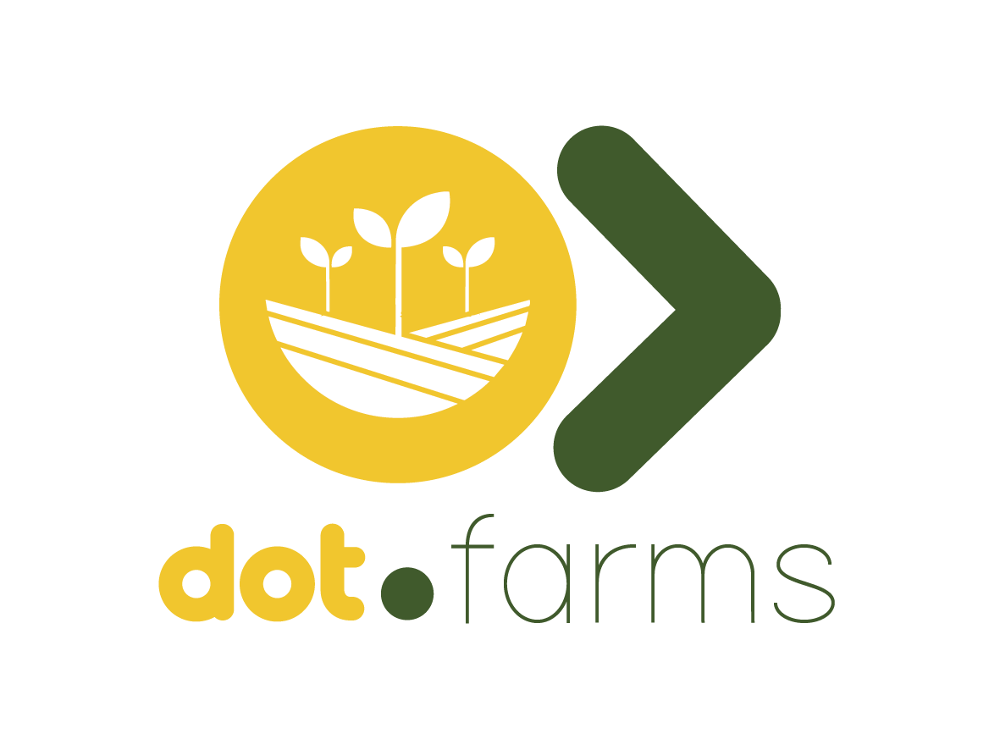

<div align="center">



<br /><br />

**The agriculture ERP for the Dot Ecosystem — farm, field, and crop-cycle tracking from paddock to gate.**

<br />

   

<br /><br />

**Part of the Dot Ecosystem** &nbsp;·&nbsp; `farms.infodot.app`

</div>

---

## What is Dot.Farms?

Dot.Farms is the agriculture ERP for the Dot Ecosystem: crop planning, planting and harvest
execution, and yield tracking for farm owners, agronomists, and field operators. It owns the
agriculture domain end-to-end from paddock to gate. Downstream commerce — produce listing and
settlement — belongs to Dot.Emall and Dot.Billing; Dot.Farms hands off the moment produce is
harvest-ready. See `wiki.md` for the full platform description.

## What it does

**Records**
- Team-scoped farm registry (Jetstream Teams: every farm belongs to exactly one team)
- Fields per farm (soil type, moisture zone, size in hectares) and a reusable team crop catalog
- Crop cycles: one crop, on one field, in one season, with planting and harvest records
- Edit and delete for farms, fields, crops, crop cycles, plantings and harvests. Deletes are soft. Deleting a farm, field or cycle that has things under it asks for confirmation and removes them with it. A crop that cycles use cannot be deleted.

**Cycle lifecycle** (one state machine, `App\Enums\CropCycleStatus`, enforced by `App\Services\Farms\CropCycleLifecycle`)
- `planned` -> `planted` (recording a planting) -> `growing` (an explicit "Mark growing") -> `harvested` (an explicit "Close as harvested"), or `failed` / `abandoned` at any open point, both with a reason; a closed cycle can be re-opened
- Harvests are accepted only while a cycle is planted or growing, and may be partial; they never close the cycle by themselves
- Correcting a harvest or planting, or deleting one, re-derives the cycle's status and planting date; every record + status change is one database transaction

**Units**
- Quantities are stored with a unit from a fixed list (kg, t, bag, crate, bunch, l, head; ha for planted area; seed and seedling counts for plantings)
- kg and t are converted and summed together; every other unit is totalled on its own. Mixed units are never added.

**Reports** (`/reports`, `/harvests`)
- Yield per field per season, per hectare where the area is known (planted hectares if recorded, otherwise the field size)
- Harvest totals per crop and month, and outstanding cycles with overdue ones first
- Harvest list with season/crop/farm/date filters and totals, and a CSV export of harvest records (`/harvests/export`, honours the same filters)

**Access**
- Team owner and `admin`: everything. `editor`: plan and edit cycles, move them through their lifecycle, record and correct plantings and harvests; cannot delete anything or change farms, fields and crops. Any other member: read-only. The full table is in `app/Policies/Concerns/ChecksFarmRoles.php`.
- Every query for fields, cycles and records is scoped to the signed-in user's current team through the farm they belong to (`forTeam()`), failing closed: no current team, no rows. Console commands and queued jobs have no signed-in user and must scope explicitly with `forTeam($team)`.

**Platform**
- In-app notification bell (Laravel's `database` channel, live over Reverb), sent after the harvest transaction commits
- Ecosystem SSO sign-in through InfoDot

Not built: yield forecasting, weather integration, moisture/sensor telemetry, record restore (deletes are soft but there is no undelete screen), outbound event publishing to Dot.Brain/Dot.Emall (the domain models describe the trigger points; nothing fires yet).

## Roles

Access follows the team (company) role. InfoDot is the source of truth and the role is re-applied at every sign-in.

| InfoDot role | Dot.Farms role | Can |
|---|---|---|
| owner, admin | admin (owner for the creator) | everything: farms, fields and crops; delete cycles, plantings and harvests |
| editor | editor | run the season: plan and edit crop cycles, move them through their lifecycle, record and correct plantings and harvests; read and export |
| viewer | viewer | read only: farms, fields, crops, cycles, harvests and the reports, and the harvest CSV export, exactly the read surface an editor has; no write control is shown and every write route answers 403 |
| anything else | viewer | an unrecognised InfoDot role gets the least powerful role, never editor |

The harvest CSV export is open to viewers because it is the same data the harvest list and the reports show and editors may export it. It is a single ability, `HarvestRecordPolicy::export()`, if that ever needs to be narrowed. The role matrix is in `tests/Feature/Farms/ViewerRoleMatrixTest.php`.

## Domain Models

- **Farm**: tenant root (`team_id`)
- **Field**: a paddock within a farm; soil type, moisture zone, size
- **Crop**: team-owned catalog entry (e.g. "Maize, Yellow dent"), reused across fields and seasons
- **CropCycle**: one crop, one field, one season (`season` is a first-class column; see the migration's docblock for why)
- **PlantingRecord** / **HarvestRecord**: operational logs against a crop cycle

## Tech Stack

| Layer | Technology |
|---|---|
| Framework | Laravel 13 |
| Language | PHP 8.3 |
| Frontend | Blade + Alpine.js 3 · Livewire 3 (notification bell) · Tailwind CSS |
| Database | PostgreSQL (shared across ecosystem) |
| Auth | Laravel Sanctum (ecosystem SSO) + Jetstream/Fortify (teams, 2FA) |
| Queue | Database queue driver |

## Quick Start

```bash
git clone https://github.com/sakhilebhayi/Dot.Farms.git
cd Dot.Farms
cp .env.example .env
composer install
npm install && npm run build
php artisan key:generate
php artisan migrate
php artisan serve
```

`php artisan db:seed` seeds nothing and is safe anywhere. For a local demo dataset (a fake two-farm
team with a `test@example.com` user), run `php artisan db:seed --class=DemoFarmSeeder`; it refuses to
run unless `APP_ENV` is `local` or `testing`.

### Running Tests

```bash
php artisan test
```

Feature tests use an in-memory SQLite connection (see `phpunit.xml`) and Laravel's RefreshDatabase
trait, so no Postgres instance is needed to run them. The report queries and the migration are written
to be portable between SQLite and PostgreSQL; the suite only exercises SQLite.

## Email via Dot.Notify

The in-app harvest notification this app already creates is also posted, server to server, to Dot.Notify
(`POST {NOTIFY_INGEST_URL}`, signed with HMAC-SHA256 over `"{timestamp}.{raw body}"` using
`NOTIFY_INGEST_SECRET`, headers `X-InfoDot-Timestamp` and `X-InfoDot-Signature`), so a company can turn
it into an email. Same trigger (a harvest record is created, after its transaction commits) and the same
recipients (every member of the harvest's team) as the in-app notification.

| Event | Sent to | `data` keys |
|---|---|---|
| `harvest.recorded` | each member of the farm's team, one event per person | `farm_name`, `field_name`, `crop`, `quantity` (two decimals, e.g. `"500.00"`), `unit`, `harvested_at` (ISO 8601), `url` |

`url` is an absolute `https` link to the harvest page in this app. The email address is only ever in
`recipient.email`; no other member's address is sent.

**What it takes for an email to go out:** nothing is sent until `NOTIFY_INGEST_URL` **and**
`NOTIFY_INGEST_SECRET` are both set, **and** the company has enabled the event in Dot.Notify (otherwise
Notify answers `no_rule` and sends nothing). A **queue worker is required** (`php artisan queue:work`):
events are queued after the harvest transaction commits, so a rolled-back harvest sends nothing, and
nothing is ever posted inside the user's request.

**Who is skipped:** Notify routes by company. For a harvest the company is the **farm's own team**
(`teams.infodot_team_uuid`), not each recipient's current team, so a harvest is never announced on behalf
of another company. A team without an `infodot_team_uuid` (not provisioned from InfoDot), or a member with
no email, is skipped, with only an info log line (event name and user id, never an address). The in-app
notification is unaffected.

**Safety:** a Notify outage or misconfiguration cannot break or slow recording a harvest. The job has a
5 second HTTP timeout, 3 tries with backoff, never throws, logs without secrets or email addresses, and a
small cache-based circuit breaker pauses calls for 60 seconds after 5 consecutive failures (jobs wait and
retry; if Notify stays down they are dropped after their third try). Retries and double dispatches share
an idempotency key, `"harvest.recorded:{harvest record id}:{sha1(recipient email)}:recorded"`, so Notify
collapses them.

## Ecosystem

**Dot.Farms** is one of the platforms in the Dot Ecosystem, connected via shared PostgreSQL and
Sanctum SSO, and via Knowledge Packs published to [Dot.Brain](https://github.com/sakhilebhayi/Dot.Brain).
See `wiki.md` for the full architecture and cross-platform relationships.

## License

MIT
